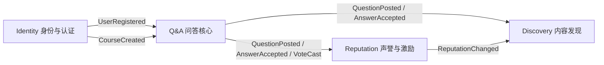

# 限界上下文图

| 上游 | 下游 | 关系 | 集成方式 |
| --- | --- | --- | --- |
| Identity | Q&A | 客户-供应商 | 领域事件 + API |
| Q&A | Reputation | 发布-订阅 | 事务性发件箱 |
| Q&A | Discovery | 发布-订阅 | 事务性发件箱 |
| Reputation | Discovery | 发布-订阅 | 领域事件 |

## 各上下文职责
- **Identity**：注册、登录、课程、角色、会话。对外只暴露 `identity-api`。
- **Q&A**：问题、回答、评论、投票、标签、采纳。核心子域。
- **Reputation**：声誉账本、徽章、悬赏、排行榜、对账。
- **Discovery**：搜索、相关推荐、通知。
